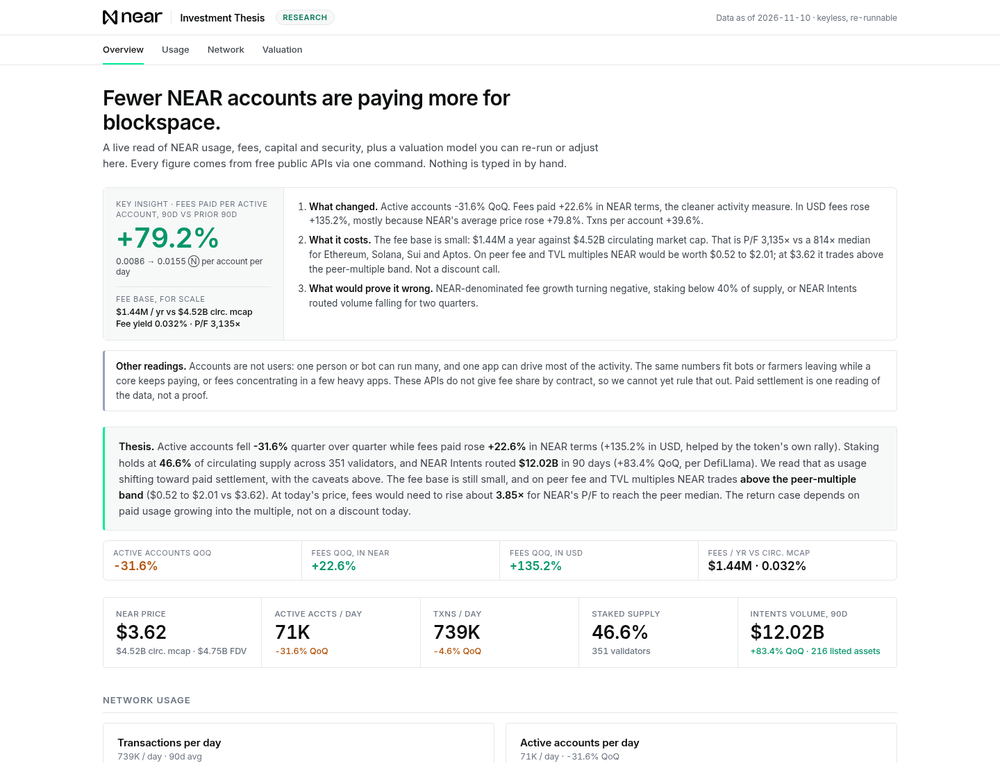

# NEAR Investment Thesis

A live onchain dashboard and a re-runnable valuation model for NEAR.
Built for the NEAR Hackathon, Investment Thesis track.

Live: https://out-sage-gamma.vercel.app



## Thesis
Fewer NEAR accounts are paying more for blockspace. Over the last 90 days,
active accounts fell 31.6% against the prior 90 days while gas fees paid rose
22.6% in NEAR terms (135.2% in USD, mostly because NEAR's price rose), so fees
paid per active account rose 79.2%. The fee base is still small: $1.44M a year
against a $4.52B circulating market cap. On live peer multiples (Ethereum,
Solana, Sui, Aptos) NEAR would be worth $0.52 to $2.01; at $3.62 it trades at
a premium to every named peer. Not a discount call. The case rests on paid
usage growing into the multiple: fees need to rise about 3.85x at today's
price to reach the peer-median price to fees.

Snapshot: 2026-11-10. `npm run build` regenerates every number, including
[THESIS.md](THESIS.md), which is written from the model output.

## Try it
1. Open https://out-sage-gamma.vercel.app. The first screen states the thesis
   and the key reading: fees paid per active account, up 79.2% QoQ.
2. Scroll to the valuation section and click Bear, Base or Bull. The
   fair-value band and the verdict update to that scenario's peer multiples.
3. Drag the P/F or Mcap/TVL slider. The scenario switches to Custom and the
   band recomputes. Click Reset to Base to go back.
4. Check any figure against its source, printed under each chart.
5. Run `npm install && npm run build` locally. It re-fetches every source,
   re-runs the model and rewrites `data/*.json`, `model/model_output.json`
   and `THESIS.md` with current numbers.

## What the dashboard shows
- The key insight, fees per active account, with the fee base next to it for
  scale, then what changed, what it costs and what would prove it wrong.
- Other readings of the same data. Accounts are not users, and the numbers
  also fit bots or farmers leaving, or fees concentrating in a few apps.
- Network usage: transactions, active and new accounts, gas fees in NEAR and
  in USD, fees per active account (derived), and NEAR price against active
  accounts, with the two 90-day windows marked.
- Capital and security: DeFi TVL, total and circulating supply, staking ratio
  and validator count, NEAR Intents listed assets per chain (breadth, not
  volume) and NEAR Intents routed volume (DefiLlama).
- Valuation: a live peer table (price, circulating mcap, annualized fees, P/F,
  fee yield, TVL, Mcap/TVL) with sources, then a fair-value band from the fee
  and TVL lenses at peer multiples, with Bear, Base and Bull presets and
  sliders. The value-per-active-account lens is shown but labelled unsourced
  and kept out of the band, since no like-for-like public peer series exists.
- Falsifiers: the conditions that would change the view, with current values
  next to each.

All ratios use circulating market cap (price x circulating supply). FDV is
shown separately. NEARBlocks' `market_cap` field equals FDV, so it is not used
in any ratio.

## Data sources
All free and keyless.

| Source | Endpoint | Used for |
| --- | --- | --- |
| NEARBlocks | `api.nearblocks.io/v1/charts` | daily txns, active and new accounts, gas fees, supply |
| NEARBlocks | `api.nearblocks.io/v1/stats` | price, supply snapshot |
| DefiLlama | `api.llama.fi/v2/historicalChainTvl/Near` | DeFi TVL history |
| NEAR RPC | `rpc.mainnet.near.org` (`validators`) | total stake, validator count |
| NEAR Intents | `1click.chaindefuser.com/v0/tokens` | listed assets and chains |
| DefiLlama | `api.llama.fi/summary/dexs/near-intents` | NEAR Intents routed volume |
| DefiLlama | `api.llama.fi/summary/fees/{chain}` | peer chain fees (Ethereum, Solana, Sui, Aptos, NEAR) |
| DefiLlama | `api.llama.fi/v2/chains` | peer chain TVL |
| CoinGecko | `api.coingecko.com/api/v3/coins/markets` | peer price, circulating mcap, FDV |

NVT is computed but left out of the band. NEARBlocks `txn_volume_usd` counts
system, staking and refund transfers, which makes NVT unreliable.

## Re-run the model
Requires Node 18+ and Python 3.

```bash
npm install
npm run build   # fetch every source into data/*.json, then run the model
npm run site    # static export to out/
npx serve out   # or any static server
```

- `scripts/fetch_data.mjs` pulls each source and writes `data/*.json`.
- `model/thesis_model.py` reads only those files and writes
  `model/model_output.json`. It exits if an input is missing.
- `model/write_thesis.py` writes `THESIS.md` from the model output.
- Fee and TVL multiples come from the live peer data. Move the sliders on the
  live page to try your own.

Method: QoQ compares the last 90 days with the 90 days before. Each lens
turns a live metric into a price with a low and high multiple. The band is the
average of the fee lens and the TVL lens. Base uses the full peer range, Bear
uses peer low to peer median, Bull uses peer high up to NEAR's own multiple.

## Layout
```
scripts/fetch_data.mjs   data fetch, no dependencies
model/thesis_model.py    valuation model
model/write_thesis.py    writes THESIS.md from the model
app/                     Next.js + Recharts dashboard (static export)
data/                    latest fetched snapshot
shots/                   screenshots
```

## Built with
- Next.js 14, React 18 and Recharts 2 for the dashboard (static export).
- Node 18 `fetch` for the data layer, no extra packages.
- Python 3 standard library for the model.
- Free public APIs listed under Data sources.
- Hosted on Vercel.

## Design
The dashboard's visual style (paper, black ink, one oxblood accent, hairlines, running heads, numbered figures) is inspired by the [Parallel, Finance](https://www.framer.com/marketplace/templates/parallel-finance/) Framer template. The code is original and uses the free Google Fonts Newsreader and Instrument Sans. No template code or assets are used.

## License
MIT. Not financial advice.
